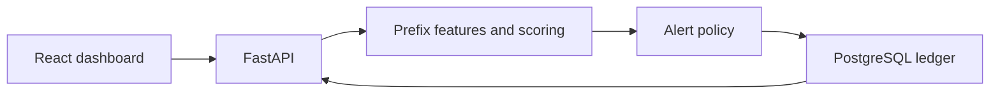

# Architecture

Offline, the generator produces chronological ticket cohorts. Training scores only eligible prefixes, fits preprocessing and classifiers on training tickets, fits sigmoid calibration on earlier validation tickets, and selects hyperparameters and rules on later validation tickets. Scoring freezes before consuming holdout rows. The Docker API runs from the selected joblib artifact. The evaluation tab reads the corresponding JSON report.

## Message transaction

1. The API validates client message UUID, role, body and timezone-aware timestamp. Context fields are fixed at ticket creation.
2. PostgreSQL locks the ticket row. An identical UUID and payload returns the original prediction. Conflicting UUID reuse, non-increasing timestamps and overlength conversations produce HTTP 409.
3. The service scores a prefix ending at the new message. It derives risk change from the prior score and checks alert history before deciding whether to alert.
4. The appended ledger record stores the message, position, score, version, level, alert decision and evidence together. Timestamps and role/text are retained in JSON. The parent lock makes concurrent ordering and retry handling consistent.

`tickets` contains the immutable creation-time context. `predictions` is the append-only message and audit ledger with unique ticket/position and ticket/message UUID keys and a risk-range check. Alert rows can be queried without joining to a notification table. Alembic owns the PostgreSQL schema.

The portfolio deployment serves internal, loopback-only traffic. The ledger limits tickets to 250 messages and the dashboard fetches up to 200 tickets and alerts. The entire prefix is reconstructed per message to keep the implementation easy to audit. Scaling beyond the demo would require paginated aggregates, measured incremental feature state, persistent lifecycle events and authentication.
